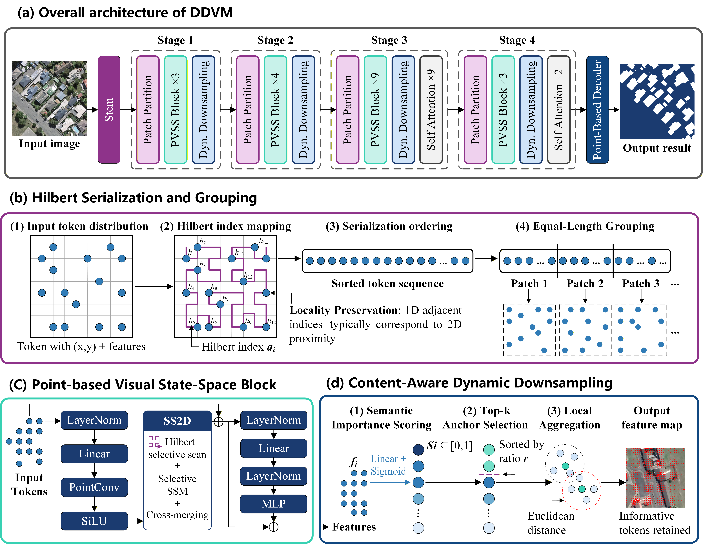

# DDVM: A Mamba-Based Method for Building Extraction from High-Resolution Remote Sensing Imagery

This repository is the official implementation of **DDVM (Dynamic Downsampling Visual Mamba)**, a novel Mamba-based framework for building extraction from high-resolution remote sensing imagery.

## Overview

DDVM addresses the challenge of preserving critical spatial information while maintaining computational efficiency in high-resolution remote sensing imagery. Unlike conventional fixed downsampling methods, DDVM introduces a content-aware dynamic downsampling strategy that adaptively allocates sampling points to information-rich regions, particularly buildings and their surroundings.

To effectively process the resulting irregular sparse features, DDVM incorporates three key components:

- **Content-Aware Dynamic Downsampling:** Adaptively selects sampling locations based on feature importance and spatial constraints to preserve informative building features while reducing background redundancy.
- **Hilbert Serialization and Irregular Patch Partitioning:** Organizes irregularly distributed sparse points into equal-length patches while maintaining spatial locality.
- **Point-based Visual State-Space Block (PVSS Block):** Integrates PointConv-based local geometric aggregation with Hilbert-based cross-scanning to capture local spatial structures and long-range contextual dependencies.

Experimental results demonstrate that DDVM achieves competitive building extraction accuracy and boundary delineation performance while effectively controlling computational costs.

## Framework

**Fig. 1.** Overall framework of the proposed DDVM. (a) Overall architecture of DDVM; (b) Hilbert Serialization and Grouping; (c) Point-based Visual State-Space Block; (d) Content-Aware Dynamic Downsampling.

## Code Availability

**The source code will be made publicly available in this repository upon acceptance of the paper.**

Currently, this repository contains only the project description and framework illustration. The implementation and relevant instructions will be provided following acceptance.
